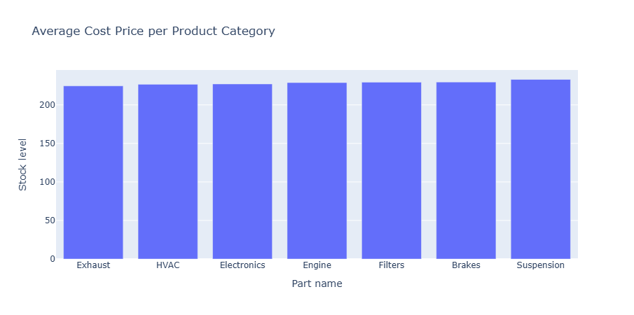
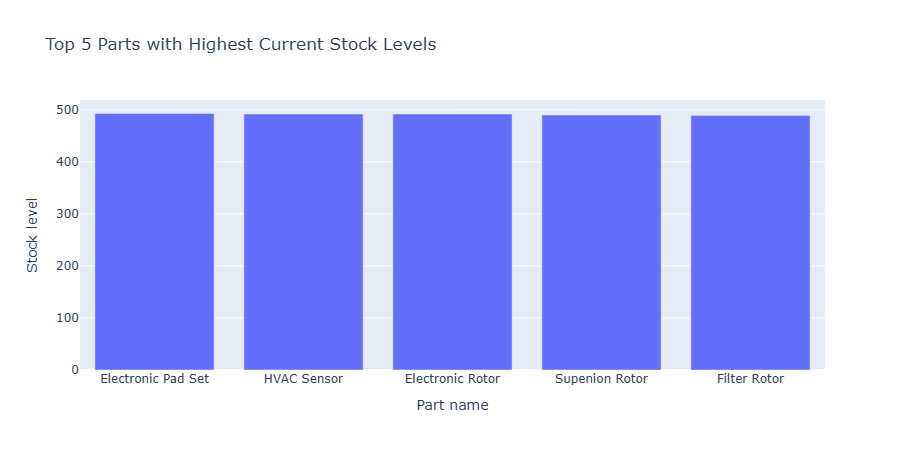
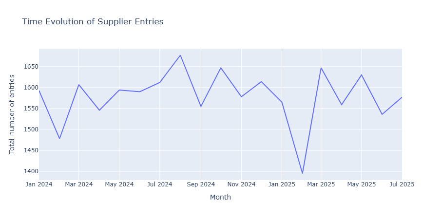

# Project: Supplier Data Integration & Analysis Pipeline

## Objective

The goal of this project is to build a reliable and automated ETL (Extract, Transform, Load) pipeline that processes raw, inconsistent data from a potential new auto parts supplier. The pipeline standardizes the data, loads it into a SQLite database alongside product metadata, and then performs an initial business analysis to assess the supplier's viability.

## Data Extraction and Transformation

This section documents the strategies used to clean and standardize the `supplier_feed.csv` dataset, as implemented in the Python script `src/transform_data.py`. The raw data contained 30,000 entries across 4 columns (`part_id`, `stock_level`, `cost_price`, `entry_date`) and was full of inconsistencies, mixed types, and significant missing values (`stock_level` and `cost_price` contained 3,936 and 1,537 null entries, respectively).

### Data Cleaning and Imputation Strategies

The cleaning of the `cost_price` column involved two steps: first, the dollar sign ($) was removed using REGEX to standardize the format. The column was then converted to a float. The 1,537 missing entries were then imputed using a strategy that leverages the temporal nature of the data: the values were sorted by `part_id` and `entry_date`, grouped by `part_id`, and imputed via linear interpolation. This approach uses the evolution of prices for a specific part over time, providing a more accurate estimate than a simple mean or median. Any remaining missing values were conservatively imputed with the column's overall median.

For the `entry_date` column, which featured various different formats such as 'YYYY-MM-DD' or 'MM/DD/YY', it was converted to the standard datetime format using the parameters `format='mixed'` and `errors='coerce'`. This results in a uniform date entry column formatted as 'YYYY-MM-DD', with any unparseable entries dropped.

Cleaning the `stock_level` column required mapping inconsistent string entries to numerical values. After identifying the minimum non-zero stock value of 5 in the clean entries, the strings containing 'low' or 'low stock' were mapped to 1, indicating a minimum supply level. 'unavailable' or 'out of stock' were mapped to 0. After this mapping, the column was converted to a nullable integer type (Int64) using `pd.to_numeric()`. Finally, all remaining missing values were explicitly flagged by filling them with -1, preserving the distinction between a true zero stock and a missing data point.

### Primary Key Creation

To ensure the clean dataset could be reliably loaded into a database, a unique primary key was required. Since a check revealed that the `part_id` and `entry_date` combination was not unique (there were 578 non-unique dates), a new sequential identifier, `stock_entry_id`, was created to serve as the unique primary key for the cleaned supplier transactions.

The final clean dataset was stored in the file `data/supplier_feed_clean.csv`.

## Data Loading

In the same script, the SQLite database `data/auto_parts.db` was created. Two tables were defined and populated: `cleaned_supplier_data` and `product_metadata`. The data types were mapped from Pandas to appropriate SQL types (e.g., datetime64[ns] to TIMESTAMP, Int64 to INTEGER).

### Database Schema

The following tables and schema were created to ensure data integrity and facilitate relational queries:

* `cleaned_supplier_data`

    | Column Name | SQL Data Type | Primary Key | Description |
    | :--- | :--- | :---: | --- |
    | `stock_entry_id` | INTEGER | YES | Unique entry identifier |
    | `part_id` | TEXT | NO | Link to product metadata |
    | `stock_level` | INTEGER | NO | Cleaned stock quantity (-1 indicates missing data) |
    | `cost_price` | REAL | NO | Cleaned and imputed cost |
    | `entry_date` | TIMESTAMP | NO | Date of stock entry |

* `product_metadata`

    | Column Name | SQL Data Type | Primary Key | Description |
    | :--- | :--- | :---: | --- |
    | `part_id` | TEXT | YES | Unique internal product identifier |
    | `part_name` | TEXT | NO | Name of the part |
    | `category` | TEXT | NO | Classification of the part |

## Data Analysis and Visualization

The analysis was conducted in the Jupyter Notebook `notebooks/supplier_data_pipeline.ipynb`. A connection was established to the SQLite database, and three separate queries were executed, joining the `cleaned_supplier_data` and `product_metadata` tables.

1. **Average Cost Price per Product Category**

    The query performed an inner join on the `part_id` columns, grouped the data by `category`, and calculated the average of `cost_price`.

    | Category | Average Price |
    | :--- | :---: |
    | Brakes | 229.62 |
    | Electronics | 227.15 |
    | Engine | 228.90 |
    | Exhaust | 224.62 |
    | Filters | 229.50 |
    | HVAC | 226.77 |
    | Suspension | 233.02 |

    The average cost price shows a relatively small variation across categories, with Suspension parts being the most expensive on average ($233.02) and Exhaust parts being the least expensive ($224.62). This suggests pricing is fairly uniform across the supplier's product range.

    

    A Bar Plot (Chart 1) was generated to visually compare the average cost price across product categories.

2. **Top 5 Parts with Highest Current Stock Levels**

    The query used the `ROW_NUMBER()` window function partitioned by `part_id` and ordered by `entry_date` (descending) to identify the most recent stock entry (`row_number = 1`) for every part. This latest data was then filtered and ranked by `stock_level`.

    | Part Name | Stock Level |
    | :--- | :---: |
    | Electronic Pad Set | 493 |
    | HVAC Sensor | 492 |
    | Electronic Rotor | 492 |
    | Supenion Rotor | 490 |
    | Filter Rotor | 489 |

    The top-ranked parts are dominated by Electronic and Rotor products, with "Electronic Pad Set" having the highest current stock at 493 units. The maximum stock level across the top 5 is consistent, indicating a high but capped inventory depth for these popular items.

    

    A Bar Plot (Chart 2) showing the stock levels of the top 5 parts was included.


3. **Time Evolution of Supplier Entries**

    To track the supplier's entry activity, the `entry_date` was truncated to the month (`year_month`), and a count of `stock_entry_id` was aggregated and ordered chronologically.

    | Month | Total Entries |
    | :--- | :---: |
    | 2024-01 | 1593 |
    | 2024-02 | 1478 |
    | 2024-03 | 1607 |
    | 2024-04 | 1546 |
    | 2024-05 | 1594 |
    | 2024-06 | 1590 |
    | 2024-07 | 1612 |
    | 2024-08 | 1677 |
    | 2024-09 | 1555 |
    | 2024-10 | 1647 |
    | 2024-11 | 1578 |
    | 2024-12 | 1614 |
    | 2025-01 | 1565 |
    | 2025-02 | 1395 |
    | 2025-03 | 1647 |
    | 2025-04 | 1559 |
    | 2025-05 | 1630 |
    | 2025-06 | 1536 |
    | 2025-07 | 1577 |

    The supplier exhibits highly consistent entry activity, with the total number of entries per month fluctuating only slightly around a mean of ∼1580. The lowest entry volume occurred in February 2025 (1,395 entries), while August 2024 saw the highest (1,677). This consistency suggests a reliable, regularized data submission process.

    

    A Line Chart (Chart 3) illustrating the Total Entries over the `year_month` timeline was used to visualize the submission trend.

## Execution Instructions

The full ETL pipeline can be executed by running the main transformation script from the project's root directory:

```bash
python src/transform_data.py
```

This single command handles data extraction, cleaning, primary key creation, database creation, and all data loading steps. The analytical findings are then generated by running the queries within the Jupyter Notebook `notebooks/supplier_data_pipeline.ipynb`.